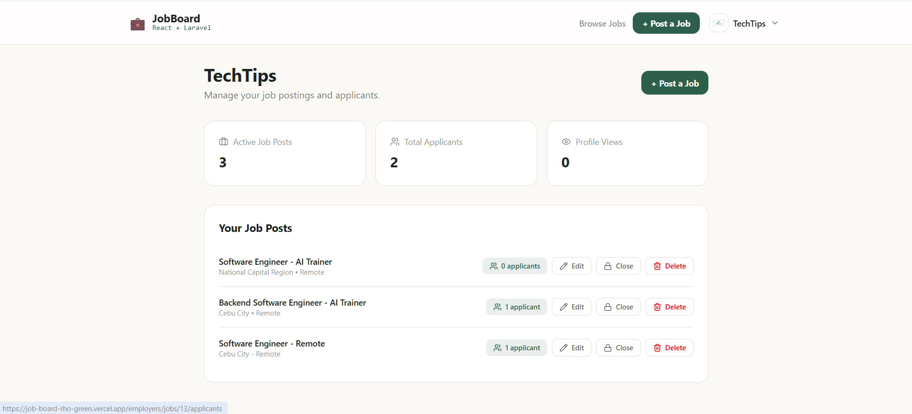
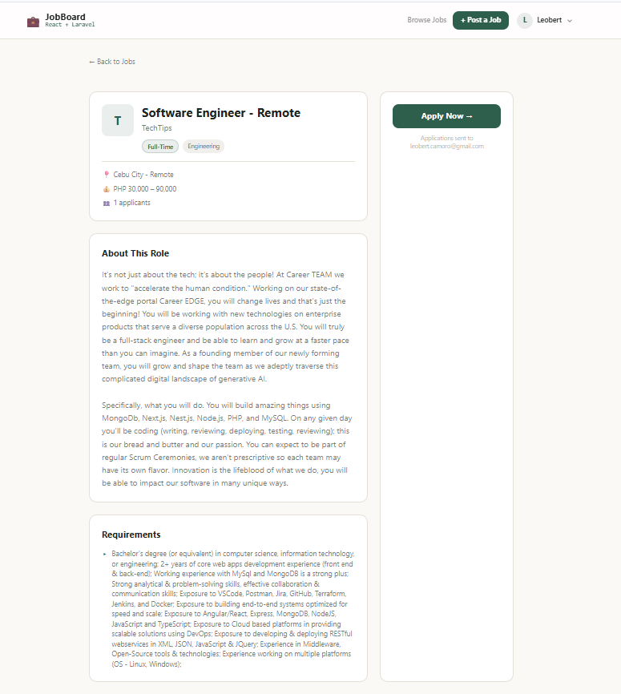
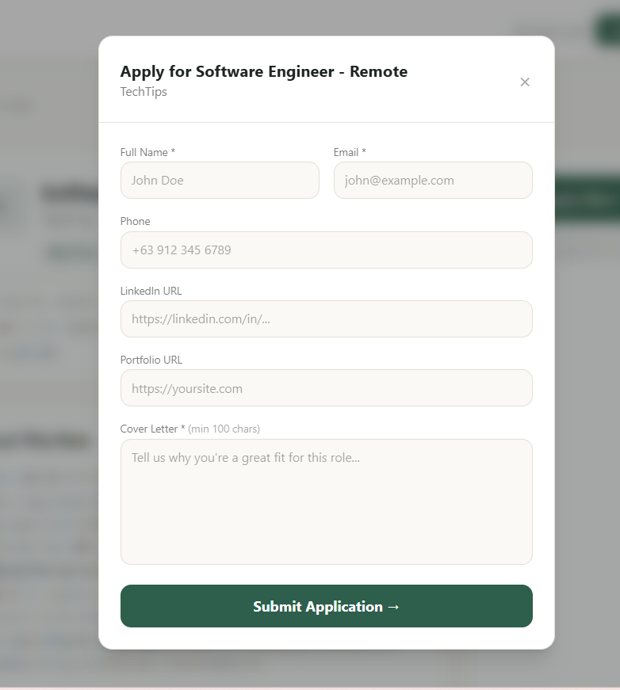
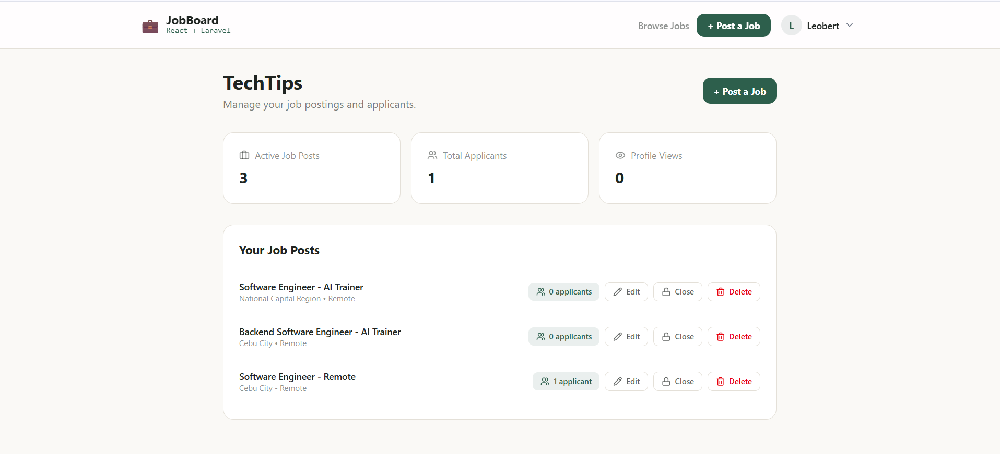
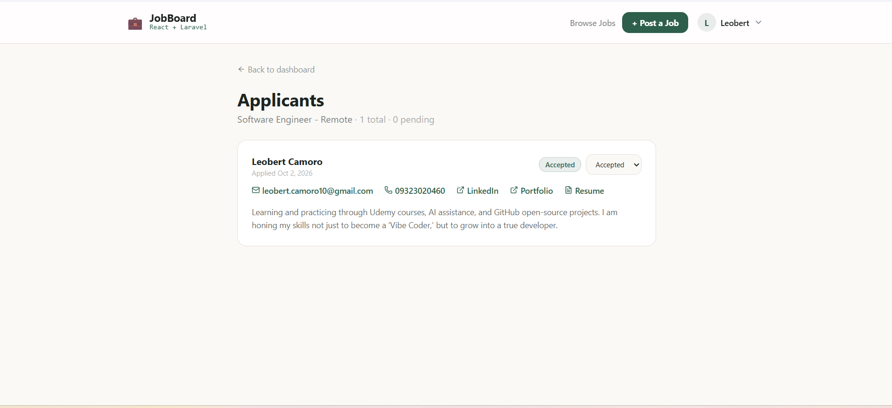
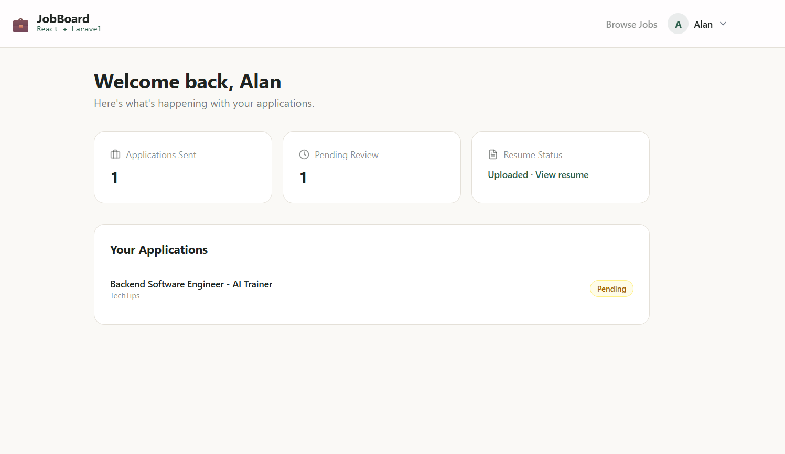
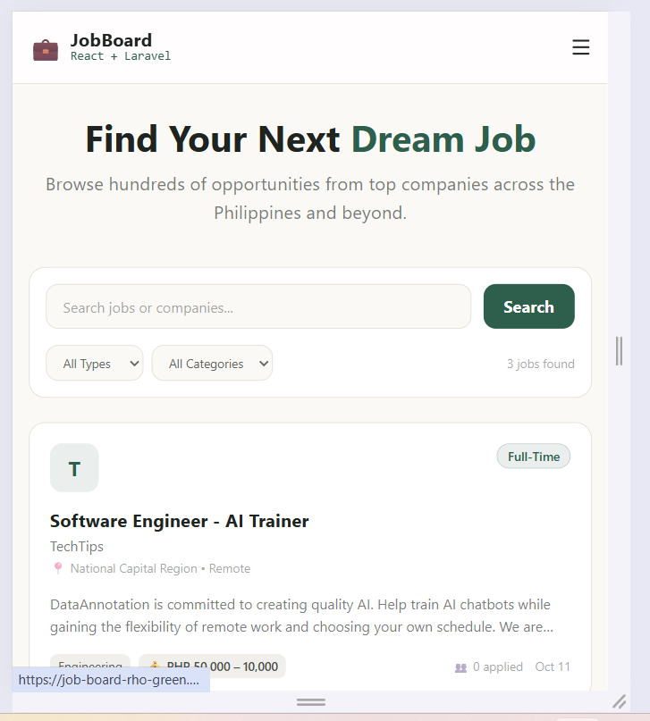

[Read the case study](docs/CASE_STUDY.md)

# JobBoard

A full-stack job board. Employers post roles and review applicants; job seekers apply and track the status of each application.

**Live demo:** https://job-board-rho-green.vercel.app

> The demo runs on hobby-tier hosting, so the first request after a quiet period can be slow. Signup sends a confirmation code by email, so use an address you can open.

## Screenshots

| Browse and search | Job detail |
|---|---|
|  |  |

| Apply | Employer dashboard |
|---|---|
|  |  |

| Applicants | Applicant dashboard |
|---|---|
|  |  |



## Features

**Job seekers**
- Browse and filter jobs by keyword, type and category
- Apply as a guest, or as a logged-in applicant with name, email and phone prefilled
- Upload a resume at signup and choose whether employers can see it
- Dashboard showing every application and its status (pending, reviewed, accepted, rejected)
- Edit profile and change password

**Employers**
- Post, edit, close/reopen and delete jobs
- See applicants per job, with contact links, cover letter and (if allowed) resume
- Move applications between statuses; applicants see the change on their dashboard
- Company profile with optional logo
- Edit profile and change password

**Platform**
- Separate applicant and employer signup, two steps each (account details, then file upload)
- Email confirmation code at signup, sent through Resend from a verified domain (SPF/DKIM); switchable
- Token authentication with role-based route guards on the frontend and ownership checks on the API
- Rate-limited login, signup and code confirmation; a pending signup is discarded after five wrong codes
- Tokens expire after one day, or 30 days with "Keep Me Logged In"
- Password reset by email: a single-use link that expires in 60 minutes, and a reset signs out every device
- Responsive layout with a mobile hamburger menu
- Route-level code splitting (lazy-loaded pages)
- Accessibility: every form field goes through one shared `FormField` component that wires the label, hint and error to the input; named dialogs with focus management; one shared `FilePicker` for resume and logo uploads (type and size checks, keyboard-reachable)
- Automated tests at three levels (see [Testing](#testing))

## Tech stack

| Layer | Tools |
|---|---|
| Frontend | React, Vite, TypeScript, Tailwind CSS v4, React Router (`createBrowserRouter`), TanStack Query, Zustand, React Hook Form + Zod, Axios, Lucide icons |
| Testing | Vitest + React Testing Library (frontend), Laravel feature tests (API), Playwright (end-to-end) |
| Backend | Laravel, Laravel Sanctum (bearer tokens), Eloquent |
| Database | PostgreSQL |
| Email | Resend, sent from a verified subdomain (optional) |
| Hosting | Vercel (frontend), Railway (API, database, file volume) |

## Architecture

```
Browser (React SPA on Vercel)
   │  HTTPS + Authorization: Bearer <token>
   ▼
Laravel API (Railway) ──► PostgreSQL (Railway)
   │
   └──► Volume mounted at storage/app/public (resumes, logos)
```

One `users` table with a `role` column (`applicant` or `employer`), plus a profile table for each role. Jobs belong to an employer; applications belong to a job and, when the applicant was logged in, to a user.

## Getting started

**Requirements:** Node 20+, PHP 8.4, Composer, PostgreSQL.

### Backend

```bash
cd jobboard-api
composer install
cp .env.example .env
```

In `.env`, point to your own database. The example file defaults to SQLite, so change it:

```
DB_CONNECTION=pgsql
DB_HOST=127.0.0.1
DB_PORT=5432
DB_DATABASE=jobboard
DB_USERNAME=postgres
DB_PASSWORD=your_password
```

Then:

```bash
php artisan key:generate
php artisan migrate
php artisan storage:link
php artisan serve
```

The API runs at `http://localhost:8000`.

### Frontend

```bash
cd jobboard
npm install
```

Create `jobboard/.env` containing:

```
VITE_API_URL=http://localhost:8000/api
```

```bash
npm run dev
```

### Signing up locally

By default signup asks for a 4-digit confirmation code. With `MAIL_MAILER=log` the email, including the code, is written to `jobboard-api/storage/logs/laravel.log`. To skip the step entirely, set `REQUIRE_EMAIL_CONFIRMATION=false` in `.env`.

## Environment variables

| Variable | Where | Purpose |
|---|---|---|
| `VITE_API_URL` | frontend | Base URL of the API, including `/api` |
| `APP_KEY`, `APP_URL`, `APP_DEBUG` | API | Standard Laravel settings (`APP_DEBUG=false` in production) |
| `DB_*` | API | PostgreSQL connection |
| `REQUIRE_EMAIL_CONFIRMATION` | API | `false` skips the emailed code (default `true`) |
| `MAIL_MAILER`, `MAIL_FROM_ADDRESS`, `MAIL_FROM_NAME` | API | Mail settings. With Resend, `MAIL_FROM_ADDRESS` must be on a verified domain |
| `RESEND_API_KEY` | API | Resend key, needed only when `MAIL_MAILER=resend` |
| `FRONTEND_URL` | API | Base URL of the React app, used to build the link in password reset emails (`config/jobboard.php`) |

## API overview

| Method | Endpoint | Access |
|---|---|---|
| GET | `/api/jobs` | public (filters: `search`, `type`, `category`, `location`) |
| GET | `/api/jobs/{id}` | public |
| POST | `/api/jobs/{id}/apply` | public (guest or applicant) |
| POST | `/api/applicant/register`, `/api/applicant/register/confirm` | public |
| POST | `/api/employer/register`, `/api/employer/register/confirm` | public |
| POST | `/api/register/resend-code` | public |
| POST | `/api/login` | public |
| POST | `/api/forgot-password`, `/api/reset-password` | public |
| POST | `/api/logout`, GET `/api/me` | authenticated |
| POST / PUT / DELETE | `/api/jobs`, `/api/jobs/{id}` | employer who owns the job |
| GET | `/api/jobs/{id}/applications` | employer who owns the job |
| PATCH | `/api/applications/{id}` | employer who owns the job |
| GET | `/api/applicant/applications` | applicant |
| GET | `/api/employer/jobs` | employer |
| PUT | `/api/profile/password` | authenticated |
| POST | `/api/profile` | authenticated |

## Testing

| Level | Tool | Run |
|---|---|---|
| Frontend unit and component | Vitest, React Testing Library, user-event (244 tests) | `cd jobboard && npm test` |
| API feature tests | Laravel / PHPUnit (67 tests) | `cd jobboard-api && php artisan test` |
| End to end (full hiring flow, accessibility) | Playwright (14 tests) | `cd jobboard && npx playwright test` |

All three run in GitHub Actions on every push. The frontend tests cover the forms, modals, auth store, API client (headers, 401 handling, multipart uploads) and the post-login redirect rules, with assertions on accessible names and error descriptions rather than markup. Vitest only picks up `src/**/*.test.{ts,tsx}`, so it never collides with the Playwright specs in `e2e/`.

The e2e job runs with `REQUIRE_EMAIL_CONFIRMATION=false` so the flow does not depend on a mailbox.

## Project structure

```
jobboard/                     React frontend
  src/api/                    Axios client and typed request functions
  src/components/             Reusable UI (Card, Modal, FormField, FilePicker, FieldError, JobCard, ...)
  src/navigation/             Navbar, dropdowns, route guard
  src/pages/guest/            Public pages (home, job detail, login, signup)
  src/pages/authenticated/    Dashboards and applicant list
  src/stores/                 Zustand auth store
  src/schemas/                Zod form schemas
  src/**/*.test.tsx           Vitest tests, next to the code they cover
  e2e/                        Playwright specs
jobboard-api/                 Laravel API
  app/Http/Controllers/Api/   Auth, jobs, applications
  app/Models/                 User, Job, Application, profiles
  database/migrations/        Schema
  config/jobboard.php         Feature switches
```

## Deployment notes

- **Frontend (Vercel):** set `VITE_API_URL` to the Railway API URL ending in `/api`. Git auto-deploys are switched off in `vercel.json`; deploys come from a deploy hook that CI calls (see Gated deploys).
- **API (Railway):** set the variables above on the API service and use the private `postgres.railway.internal` host for `DB_HOST`.
- **Uploads:** attach a volume to the API service at `/app/storage/app/public`, otherwise resumes and logos disappear on every redeploy. The `public/storage` symlink is created automatically on boot.
- **Mail:** Resend only delivers to your own address until you verify a sending domain. Add the DKIM and SPF records Resend gives you, wait for the domain to show Verified, then use an address on it for `MAIL_FROM_ADDRESS`. Until then, signup fails with "couldn't send the confirmation email" unless `REQUIRE_EMAIL_CONFIRMATION=false`.

## Gated deploys

Nothing reaches production unless CI passes.

1. A push to `main` runs `api-tests`, `frontend-build` (build and unit tests) and `e2e`.
2. A final `deploy` job runs only if all three succeed, and calls a Vercel deploy hook stored as the GitHub secret `VERCEL_DEPLOY_HOOK_URL`.
3. Railway has **Wait for CI** switched on, so the API deploys only after the same workflow succeeds.

Pull requests run the tests but never deploy. I checked the failure path by pushing a deliberately broken commit: the build job failed, the deploy job was skipped, Vercel created no deployment, and Railway marked the deploy as skipped.

## Security

- **Authorization in the API:** ownership and role checks on every protected action, covered by feature tests. The UI guards are cosmetic.
- **Tokens:** Sanctum bearer tokens with a per-token expiry (one day, or 30 days when "Keep Me Logged In" is ticked). Changing a password needs the current one and signs out other devices.
- **Signup codes:** four digits, valid for 15 minutes, and a pending signup is discarded after five wrong guesses. Login, signup, confirmation and resend are rate limited by email and IP.
- **Password reset:** the API gives the same answer whether or not an email has an account, so it can't be used to find users. Reset tokens are single-use and expire after 60 minutes, a reset signs out every device, and both endpoints are rate limited.
- **Uploads and input:** type and size validated on the client and the server; every form is validated with Zod and again by Laravel.
- **Frontend headers:** `X-Content-Type-Options`, `X-Frame-Options`, `Referrer-Policy` and `Permissions-Policy` from `vercel.json`, plus a `Content-Security-Policy-Report-Only` header that I will enforce once it has run clean on every page.
- **Deploys:** secrets live in environment variables and GitHub secrets, and nothing deploys unless CI passes.

## Known limitations

- Uploaded resumes are stored on a public disk under unguessable file names
- The auth token is kept in browser storage, the usual trade-off for a single-page app

## Roadmap

- Private resume storage with signed, expiring links
- Enforce the Content-Security-Policy once it has run clean on every page

## Author

Leobert Camoro, software engineer based in Cebu City, Philippines.

[GitHub](https://github.com/leobertcamoro101-lab) · [Portfolio](https://portfo-leo-puce.vercel.app/) · [LinkedIn](https://www.linkedin.com/in/leobert-camoro-1b811a231/)